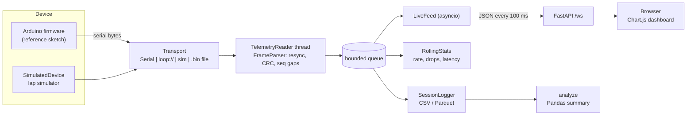

# sim-telemetry

A real-time telemetry pipeline for a serial-connected driving-simulator rig. A microcontroller
(or the built-in simulator) streams compact binary frames - steering, throttle, brake, gear,
speed, rpm - over a serial line; the Python host decodes them in a background thread, survives
corrupted and missing bytes, logs sessions to CSV/Parquet, shows a live browser dashboard over
WebSocket, and summarises recorded sessions with Pandas. Everything runs without hardware: a
simulated car laps a simple track and produces physically consistent data, either in-process
or through a real pyserial `loop://` port. The project grew out of my Smart India Hackathon 2025
driving-simulator work, where the rig's hardware streamed telemetry to Python via PySerial; this
is a cleaned-up, standalone rebuild of that idea, not the hackathon code itself.

## Architecture



## Frame format

All multi-byte fields are little-endian. One frame is 20 bytes.

| Offset | Size | Field          | Type   | Notes                                              |
|-------:|-----:|----------------|--------|----------------------------------------------------|
| 0      | 2    | sync           | bytes  | `0xAA 0x55`, marks the start of a frame            |
| 2      | 1    | length         | u8     | payload length, `9` for this payload version       |
| 3      | 2    | seq            | u16    | increments per frame, wraps at 65535 -> 0          |
| 5      | 4    | timestamp_ms   | u32    | device clock, ms since boot                        |
| 9      | 9    | payload        | -      | see below                                          |
| 18     | 2    | crc16          | u16    | CRC-16/CCITT-FALSE over bytes 2..17 (length..payload) |

Payload (fixed-point integers keep the frame small):

| Offset | Size | Field     | Type | Unit / scale                       |
|-------:|-----:|-----------|------|------------------------------------|
| 9      | 2    | steering  | i16  | 0.1 degree, negative = left        |
| 11     | 1    | throttle  | u8   | percent 0-100                      |
| 12     | 1    | brake     | u8   | percent 0-100                      |
| 13     | 1    | gear      | i8   | -1 = reverse, 0 = neutral, 1-6     |
| 14     | 2    | speed     | u16  | 0.01 km/h                          |
| 16     | 2    | rpm       | u16  | revolutions per minute             |

## Quickstart

Requires Python 3.12+.

```bash
git clone https://github.com/RutuK2005/sim-telemetry.git
cd sim-telemetry
python -m venv .venv
# Windows: .venv\Scripts\activate      Linux/macOS: source .venv/bin/activate
pip install -e ".[dev]"        # or: pip install -e ".[parquet]" without the test tools
```

```bash
# Peek at a few frames: raw hex plus decoded values
sim-telemetry simulate --count 5

# Record 30 s from the in-process simulator, with 2 % of frames damaged on purpose
sim-telemetry record --port sim --out session.csv --seconds 30 --noise 0.02

# Same, but the bytes travel through a real pyserial port (loop://)
sim-telemetry record --port loop:// --out session.parquet --seconds 30

# Write a 2-minute raw capture, then replay it through the full pipeline
sim-telemetry simulate --out capture.bin --seconds 120 --noise 0.01 --seed 7
sim-telemetry record --port capture.bin --out replay.csv
sim-telemetry analyze replay.csv

# Summarise a session: max speed, avg throttle, braking events, gear usage
sim-telemetry analyze session.csv

# Live dashboard at http://127.0.0.1:8000
sim-telemetry serve --source sim --noise 0.01
```

With real hardware, use the serial port name instead of `sim`, e.g.
`sim-telemetry record --port COM3 --out session.csv` or `--port /dev/ttyUSB0`. `--baud`
defaults to 115200. `python -m sim_telemetry ...` works too.

`analyze replay.csv` for that seeded capture prints (simulated data, trimmed):

```
Samples            5960
Duration           120.0 s
Max speed          213.9 km/h
Average throttle   64.6 %
Braking events     10
Dropped packets    40
Gear usage
   4  ###################                       47.8%
   5  ################                          39.2%
   ...
```

## Design decisions and trade-offs

- **Sync word + length + CRC.** Serial is a byte stream with no message boundaries. The sync
  word gives the parser something to search for, the length byte says where the CRC sits (and
  leaves room for future payload versions), and the CRC rejects corrupted frames. CRC-16 catches
  all single-bit and burst errors up to 16 bits, which a simple additive checksum does not.
- **Resync by skipping one byte, not one frame.** When a CRC fails, the "frame" may have been a
  false sync inside garbage, with a real frame starting a few bytes later. Dropping just the first
  byte and searching again recovers that frame. The fuzz tests check this with random garbage,
  planted fake sync words and bit flips, fed in random chunk sizes.
- **Sequence numbers for loss detection.** A CRC failure and a byte lost by the UART both show
  up as a gap in `seq`. A backwards jump is counted as a device reset instead of ~65k drops.
- **Fixed-point payload.** Integers with a known scale (0.1 deg, 0.01 km/h) keep frames at
  20 bytes and are cheap to produce on a microcontroller without floating point.
- **Reader thread + bounded queue.** The serial port must be drained continuously; consumers
  (disk, web) can stall. The queue decouples them. For live sources a full queue drops the
  *oldest* frame (fresh data matters most and the reader never blocks); for file replays the
  reader blocks instead (backpressure), because nothing is lost by waiting.
- **Latency without synchronised clocks.** The device only knows "ms since boot". The stats
  track `host_time - device_time` and report it relative to the best frame seen, which measures
  buffering delay and jitter rather than true one-way latency.
- **Batching to the browser.** The dashboard pushes one JSON message every 100 ms containing
  all new samples, instead of one message per frame, so the browser redraws 10 times a second.
- **CSV streams, Parquet buffers.** CSV rows are flushed as they arrive (crash-safe); Parquet
  is columnar, so rows are buffered and written on close. Fine for sessions of minutes, not days.
- **Pure-Python parser.** Easy to read and test. On my development laptop (Python 3.14,
  Windows) `python scripts/bench_parser.py` decoded 100,000 frames in 0.54 s (about 186,000
  frames/s); a 115200-baud link carries at most 576 of these 20-byte frames per second, so the
  parser is not the bottleneck. Numbers will differ on other machines - run the script yourself.

## Project layout

```
src/sim_telemetry/
  protocol.py    frame layout, CRC-16, encode/decode
  parser.py      streaming decoder: resync, CRC check, drop detection
  simulator.py   track + lap simulator, simulated device, link noise
  transport.py   Serial / loop:// / in-process sim / file transports
  reader.py      background reader thread and bounded queue
  stats.py       rolling packet rate, drop rate, latency
  logger.py      CSV / Parquet session logger
  analysis.py    Pandas session summary
  dashboard.py   FastAPI app + WebSocket feed
  static/index.html  single-page dashboard (Chart.js 4.4.1 from cdnjs)
  cli.py         argparse CLI
firmware/        reference Arduino sketch emitting the same frames
scripts/         parser benchmark
tests/           pytest suite
docs/walkthrough.md  study guide
```

## Running tests

```bash
pytest            # unit, fuzz, threading, CLI and WebSocket tests; no network needed
ruff check .
ruff format --check .
```

CI runs the same commands on Ubuntu with Python 3.12 and 3.13.

## Reference firmware

`firmware/sim_telemetry_reference/sim_telemetry_reference.ino` is a short Arduino sketch that
reads steering/pedal potentiometers and paddle shifters and emits the same 20-byte frame at
50 Hz. It is reference code for reading alongside `protocol.py`: pin numbers and calibration are
placeholders, and it has not been flashed to hardware as part of this repository. A unit test
rebuilds a frame byte-by-byte the way the sketch does and checks it matches `encode_frame`.

## Next steps

- Device-to-host commands (e.g. force-feedback strength) using the same framing in reverse.
- A Parquet writer that flushes row groups periodically, for long sessions.
- Lap detection and lap-by-lap comparison in `analyze` (needs a position or lap-beacon field).
- Estimate clock drift between device and host instead of using a fixed best-case offset.
- Move the CRC to a C extension or `crcmod` if much higher frame rates are ever needed.

## License

MIT - see [LICENSE](LICENSE).
