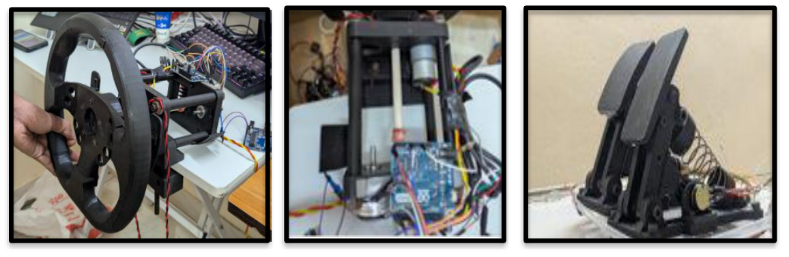
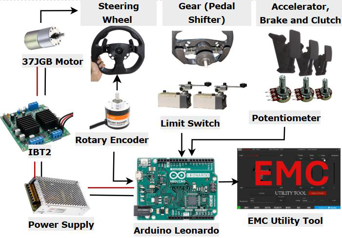
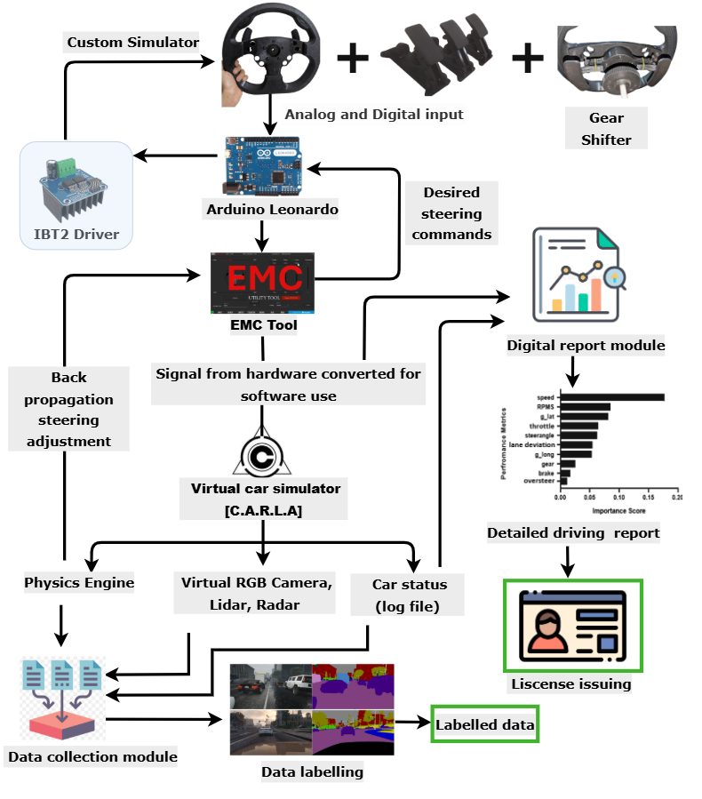

# The hardware: SIH 2025 driving simulator

This is the rig that `sim-telemetry` grew out of. Our team (X86, DY Patil International University) built it for Smart India Hackathon 2025, problem statement SIH25119 (Student Innovation, theme: Smart Vehicles, hardware category), and it won the internal round.

Demo video: https://www.youtube.com/watch?v=30tbnoA9A_E

## The idea

Training self-driving models needs a lot of labelled driving data, and collecting it on real roads is expensive and risky. Commercial sim wheels are built for gaming, not for measuring how someone actually drives.

We built a low-cost simulator with a steering wheel, three pedals and paddle shifters, connected to the CARLA simulator. Every session produces logged, labelled data. The same rig could also be used for driving tests: a learner drives a set route and gets a detailed report instead of a pass/fail from an examiner.

Most of the structural parts are 3D printed.

## Components

| Part | What it does |
|---|---|
| Arduino Leonardo | Reads every sensor. Picked because it has native USB HID, so the PC sees it as a game controller without extra drivers. |
| 600 PPR optical rotary encoder | Steering angle. Geared 1:4 to the wheel, so one wheel turn gives 2400 pulses. |
| 3 × 20k potentiometers | Accelerator, brake and clutch pedals (analog). |
| Limit switches | Sequential paddle shifters (gear up / gear down). |
| IBT2 motor driver + 37JGB motor | Force feedback on the steering wheel. |
| 120 W power supply | Powers the motor side. A custom VGA cable carries the wheel signals. |
| EMC Utility (PC) | Turns the Leonardo's raw inputs into standard controller axes/buttons any sim can use, and sends force-feedback commands back. |
| CARLA | The driving simulator: physics, virtual RGB camera / lidar / radar, and the car-state log. |

## How data flows

1. The wheel, pedals and shifters feed analog and digital signals into the Leonardo.
2. The Leonardo shows up on the PC as a controller. The EMC Utility maps its inputs for CARLA.
3. CARLA runs the car. Its physics output drives force feedback: steering force goes back through EMC to the Leonardo, which drives the IBT2 and motor.
4. CARLA's sensors and car-state log go to a data-collection step, which produces labelled data, and to a report module that summarises the drive (speed, throttle, steering, lane deviation, braking and so on).

## Cost vs a commercial wheel

From our SIH comparison slide:

| | Logitech G29 | Our rig |
|---|---|---|
| Cost | ₹33,749 | ₹6,700 |
| Steering sensor | Hall effect | Rotary encoder |
| Torque | 2.1 Nm | 6 Nm (our motor's rating) |
| Data logging | No | Yes |
| Custom wheel / real car buttons (indicators etc.) | No | Yes |

The G29 is far more polished. Ours was a working prototype, and the structure was still being improved when we presented it.

## How this repo relates to the rig

On the hackathon rig, the Leonardo talked to the PC as a USB game controller through the EMC Utility. This repo looks at the logging side separately: the microcontroller streams its readings as small framed packets over serial, and a Python host decodes, checks and records them, independent of whatever game is running.

`firmware/sim_telemetry_reference/` is a reference sketch written for this repo. It uses the same sensor set as the rig (encoder steering, three pedals, two shifter switches) and emits the frame format in [`protocol.py`](../src/sim_telemetry/protocol.py). It is not the firmware we ran at SIH, and it hasn't been flashed to the rig.

The current frame has no clutch field. Adding it means bumping the payload version, which is on the list of next steps.
